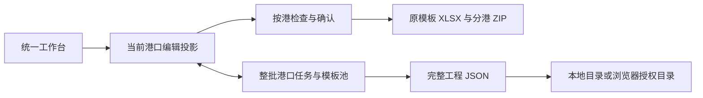

# IMO Studio：整体制作思路与开发交接

> 3.2.2 当前入口：outputs/IMO_Liquid_Glass_3.2.2.html。先读第 20 节的航次归属、完成挂靠和发布接续；第 19 节保留模板替换与玻璃加强背景。

版本：3.2.2  
程序更新日期：2026-10-21  
作者署名：作者：郑晓天 / Author: Zheng Xiaotian  
本文件用途：换电脑、换开发环境或换协作工具时，恢复产品背景、规则、代码入口和验证方法。

## 1. 产品解决什么问题

在船上离线准备进出港文件，复用船舶与船员档案，并一次准备后续多个港口。按既有 Excel 原模板写入资料，保留原版式和工作表结构。所有资料在本机处理，不依赖外部服务。

日常流程为：

> 打开工程 → 添加或选择港口 → 填人员、物料与申报 → 检查并生成 → 保存工程。

一港和多港使用同一个工作台。一个工程保存整批准备进度，ZIP 是申报用输出，库存快照是一次盘点记录。这三个概念应始终区分。

## 2. 3.0 为什么全面重置

用户已明确否定 2.1 的固定侧栏与官网极简结合版，要求跳出原框架、全面重置为充分表达 Liquid Glass 的页面。3.0 的业务模式仍是同一份离线多港工程，界面拓扑和视觉源已替换。

不再常驻十八项左侧菜单。顶部保留小型工程上下文和独立靠港胶囊，底部悬浮操作坞提供航次、文件、资料、输出、保存与生成。中央是宽幅玻璃编辑面，文件与常用资料采用按需展开的原生 popover。首次使用为大标题与真实港口入口组成的开放工作台。

3.1 保留这一拓扑，材质改用用户指定的 yzrt 纯 CSS 源码：对向内阴影、斜向高光、内层软白边和下侧暗缘。Canvas 仅在尺寸、主题或配色变化时重绘，不加载 SVG 位移映射；表格保持可读背板，系统减少动态／透明度优先。当前证据在 .impeccable/review/yzrt/。

## 3. 页面与内容归属

| 入口 | 内容 |
| --- | --- |
| 顶部港口条 | 切换正在准备的港口；省略号管理任务、完成挂靠；添加港口 |
| 底部航次 | 本港资料、未来港口计划、历史挂靠港；港口库与自定义 |
| 底部文件 | 两份船员名单、个人物品、港口清单、物料、健康与病例、旅客、药品、NIL、疫苗；人员变动与文件预览也在此 |
| 底部资料 | 申报默认方案、船舶档案、船员档案、工程记录、总设置 |
| 底部输出 | 选择本港要输出的文件、检查问题、查看待写入模板 |
| 右上角齿轮／帮助 | 设置与详细操作说明 |
| 底部保存／生成本港 ZIP 或批量生成 N 港 | 保存全部工程；或集中核对后生成选定港口的 ZIP |

文件标题也能打开文件面板；Ctrl / Command + K 搜索，Enter 进入首个匹配文件，Esc 一次关闭并返回焦点。原生 popover 允许点击外部收起。移动端使用同一套文件资料库，不依赖隐藏的桌面侧栏或嵌套标签。

WorkspaceUI 的临时视图状态不进入业务数据。ViewMemory 仍按工程、港口和文件保存主区域、表格双轴、展开区域和输入焦点。显示首页时应移除旧编辑面的光学 filter，避免空白区域出现矩形裁切。

## 4. 交付与开发目录

```text
项目根目录/
├─ README.md
├─ 制作思路与开发交接.md       ← 本文件
├─ package.json               ← 锁定顶层开发依赖版本和常用命令
├─ requirements-dev.txt       ← 独立 XLSX 检查所需 openpyxl
├─ work/
│  ├─ app.html                ← HTML 外壳、离线策略及脚本装配顺序
│  ├─ app_shell.js            ← 开放工作台、文件库、港口切换与集中核对
│  ├─ liquid_desk.css         ← 工作台布局与基础组件
│  ├─ yzrt_material.css       ← 有来源说明的 CSS 材质
│  ├─ appearance.css          ← 外观模式、系统偏好与矮屏覆盖
│  ├─ css_glass.js            ← 按需背景绘制与偏好同步
│  ├─ declaration_defaults.js ← 四类申报默认内容、校验与应用
│  ├─ effects_archive.js      ← 个人物品快照、身份匹配、导入导出
│  ├─ view_memory.js          ← 按工程/港口/文件的滚动与焦点
│  ├─ app_help.js             ← 与新流程一致的产品帮助
│  ├─ core.js / engine.js     ← 基础数据、XLSX 读取与生成
│  ├─ ui.js                   ← 可复用编辑器、导入与基础操作
│  ├─ layout.js               ← 超量插行、位置移动和一页打印
│  ├─ multiport.js            ← 独立港口资料、快照投影、工程兼容
│  ├─ multiport_export.js     ← 逐港检查、整批 ZIP、成功记录
│  ├─ route_inventory.js      ← 无界面的连续库存计算
│  ├─ multiport_stock.js      ← 推算参数、预览、保护与应用
│  ├─ project_storage.js      ← 原生与浏览器工程保存、轮换及恢复
│  ├─ LocalLauncher.cs        ← Windows 托盘与本机保存服务源码
│  ├─ IMO_Launcher.exe        ← 已编译启动器，构建时复制到交付包
│  ├─ build.py                ← 构建单 HTML 和文件夹离线版
│  ├─ package_v31.py          ← 生成干净的交付包与开发源码包
│  ├─ make_v31_guide.mjs       ← 从实际帮助页面导出离线新手说明
│  ├─ default-input/cleaned/  ← 构建用 10 份清理空模板
│  ├─ default-templates.zip   ← 与内置空模板一致的压缩包
│  ├─ config.json            ← 初始字段映射
│  ├─ default-config.json    ← 内置模板对应映射
│  ├─ port-catalog.json       ← 港口中文名、国家、识别代码及候选
│  └─ verify_*.mjs / *.py     ← 检查脚本和人工测试资料
└─ outputs/                   ← 构建及发布结果，不属于用户运行资料
   ├─ IMO_Generator.html
   ├─ IMO文件包生成器/
   │  ├─ 启动生成器.exe
   │  ├─ 打开生成器.html
   │  ├─ assets/
   │  ├─ 内置空模板/
   │  ├─ 配置参考/
   │  └─ 保存工程/            ← 发布时必须为空
   └─ *.zip
```

完整源码工作目录里可能有更早版本的开发工具。实际装入程序的模块以 `app.html` 和 `build.py` 的清单为准，不要把所有 JS 文件随意拼在一起。开发源码 ZIP 只整理当前构建入口、所需模板和主要可复现检查，不包含本机依赖缓存、用户工程或历史测试输出。

## 5. 技术方案及取舍

### 5.1 浏览器为主，Windows 启动器为辅

前端使用原生 HTML、CSS 和 JavaScript，没有服务器数据库、前端框架或在线依赖。构建后使用经典本地脚本，兼容直接双击 HTML 的 file:// 模式。

Windows 启动器提供托盘、默认同目录保存、自定义保存目录、另存为及最新工程恢复。它只监听本机 127.0.0.1，使用随机会话 token 和来源检查保护接口。界面不向外部服务上传资料。

普通用户不需要 Node 或 Python。开发和构建时才需要它们。其他系统可以使用浏览器版；Windows 托盘与默认目录服务是平台特有部分。

### 5.2 模板直接编辑 OOXML

使用 JSZip 打开 XLSX，按配置更改原有 XML，而不是把表格转换成另一套文档再导出。这样可以保留原字体、边框、图片、合并区域、列宽、行高及打印设置。

字符串以独立字符串单元格写入，避免更改共享字符串导致无关单元格串改。历史动态数据区明确清理。已知公式更新缓存，其他公式标记打开后重算。

任意模板变化须经过实际工作表、位置和合并区域校验，不能凭文件名猜写入位置。

### 5.3 统一外壳，保留稳定业务边界

work/app_shell.js 是最终渲染路径，work/app.html 提供壳体。APP_STYLE 顺序拼接 liquid_desk.css、yzrt_material.css、appearance.css；后两者负责实际材质和偏好／矮屏覆盖。旧 document_shell.css、fusion_glass.css 不再加载；v12 / workflow / multiport 保留领域编辑结构。

文件资料库使用原生 popover，不用 modalRoot 模拟普通导航。后者只用于保护性确认、恢复预览、导入映射和生成核对。点击文件后关闭资料库再渲染；搜索输入的 Escape 必须显式处理，避免 type=search 的原生清空行为截获关闭。

css_glass.js 最后加载，保留 StudioGlass 对象。背景缓存键为尺寸、主题、配色；DPR 上限 1.25 且最终像素上限 2,000,000，不做持续 JS 重绘。可选 CSS 合成层缓慢移动，隐藏页面暂停，减少动态时关闭。减少透明度／清晰模式移除模糊和装饰高光。没有 SVG filters、位移图或表格监听；渲染不改业务及导出。

全局基础字号和表格字号独立，主题、常用配置和工程兼容逻辑保留。自动申报开关必须使用 input[type=checkbox][data-default-auto] 的完整选择器，避免基础复选框尺寸把 34×21 的开关压缩。

## 6. 核心数据模型

工程格式保留 `kind: IMO-PROJECT`、`schema: 1`，增加的多港口模型为可选字段。旧单港工程无需先转成新文件格式才能读取。

简化结构如下，示例省略实际人员、证件和模板内容：

```json
{
  "kind": "IMO-PROJECT",
  "schema": 1,
  "state": {
    "ship": {},
    "people": [],
    "arrival": [],
    "departure": [],
    "voyage": {},
    "stores": [],
    "multiport": {
      "version": 1,
      "activeId": "task-id",
      "selectedIds": ["task-id"],
      "shared": {},
      "templateSets": {},
      "inventory": {},
      "tasks": [
        {
          "id": "task-id",
          "planId": "route-stop-id",
          "data": {},
          "templateKey": "template-version-key",
          "outputs": [1, 2, 4, 5],
          "confirmed": {"dates": false, "health": false, "nil": false},
          "manual": {},
          "stale": [],
          "lastExport": null,
          "status": "draft"
        }
      ]
    }
  },
  "config": {},
  "templates": []
}
```

### 6.1 当前港口是编辑投影

既有生成器继续使用全局 `state`、`CONFIG`、`templates`。选择一港后，`MultiPort` 把本港的独立快照投影到这些变量上，让原编辑器和生成逻辑继续工作。

- `MultiPort.flush()`：把当前编辑投影写回对应港口，识别单港手改及后续影响。
- `MultiPort.snapshotFor(id)`：获得指定港口独立资料，同时使用完整共享航线。
- `MultiPort.switchTask(id)`：验证并恢复该港资料和模板。
- `MultiPort.withTask(id, callback)`：临时切到该港进行检查或生成，结束或抛错后必须恢复原状态。
- `MultiPort.transact(callback)`：统一应用一批同步修改，避免半套结果。

临时投影期间锁定操作、跳过定时保存。此时调用工程打包，也必须保存原始完整工作台，不能把一港临时状态当成整批工程。



### 6.2 人员关联使用稳定标识

船员档案使用稳定 ID，进港和离港名单保存人员 ID 与本次覆盖值。个人物品、病例、疫苗按同一人员关联，不按表格行号配对。排序不能串人。

导入时，人员标识、护照、海员证若指向不同人员，整批拒绝；正常证件更新仍保留原人员 ID。空白、0、NIL 必须区分。

### 6.3 港口独立与共享资料

建立港口时冻结共同船舶、船员档案及模板版本。共享区保留最新共同资料与完整航线，供新任务和明确同步使用。修改一港不会静默重写其他港，尤其已确认或已生成的港口。

同步默认保护本港人工修改；明确覆盖时才替换。模板池按版本共用，缓存还要验证实际内容，不能只凭 key 相同就复用另一工程的模板。

## 7. 连续库存的计算思路

计算核心 `RouteInventory.calculate()` 与界面分开，方便独立验证。

### 输入

- 一份固定起始盘点：日期、港口、逐项库存。
- 完整航线中的各计算站：到离港日期、进离港人数。
- 伙食：本单位／人／天；其他物料：可选的本单位／天。
- 各港到港或离港补给。
- 分段总人数覆盖，以及按港按阶段的人工盘点修正。

### 每段计算

1. 从前一站离港库存出发，扣除航行消耗。
2. 加入本港到港补给，得到到港库存。
3. 扣除停泊消耗。
4. 加入离港补给，得到离港库存，继续传到下一站。

伙食消耗为人数 × 天数 × 定额。航行默认用前港离港人数，第一段用第一港进港人数；停泊默认用本港进港人数。手填人数是该段总人数，已包含旅客，不再重复叠加。

以 UTC 日历日期差计算，不额外加一天。不同单位、不同存放位置的物料不能混算或自动换算。

例：100 kgs 大米，10 人航行 5 天，每人每天 0.2 kgs，到港前 90；补给 20 后到港 110；停泊 2 天再耗 4，离港 106。

### 必须保留的保护

- 起始盘点固定，重复预览不反复扣减。
- 未输出文件的中间站也参加推算；缺独立人员任务时显示继承假设，并允许调整人数。
- 起点跨过未纳入的前序港口时阻止漏算，要求补站或改起点。
- 缺日期、缺伙食定额、非数值库存、负库存、单位或位置不匹配时，不允许应用。
- 0 是有效标准，空白不等于 0，NIL 不等于 0。
- 后续补给或人工盘点不能掩盖此前已发生的短缺。
- 人工盘点按 arrival、departure 分别保护，修正结果作为后续起点。
- 先预览，再整体应用；资料变化后旧预览失效，不能部分写入。

估算是操作辅助，申报前仍须结合真实盘点核对。

## 8. 输出与打印的既定规则

1. 保留 10 类原始 XLSX、原工作表及其顺序，不生成续页工作表。
2. 超量明细插入行，移动有关合并与签署位置，设置每张原工作表 fitToWidth=1、fitToHeight=1。
3. 健康主表与病例附表保留为两张原工作表，分别一页。
4. 港口清单每港只输出最近 10 次，编辑区保留完整历史；结合该港之前的计划站，排除当前和之后的站。
5. 船舶物料按存放位置先写大类标题，再列物料、数量和单位，不逐项重复 Storage。
6. 上船地点按“港口,国家”输出，选择港口时保留相关识别信息。
7. 原模板不带签署日期的，默认不额外添加日期。用户可按字段或单元格关闭输出。
8. 页面作者署名不得进入生成 Excel。
9. 一页缩放设置不等于实际打印可读性已经验收；记录很多时字会缩小，须在 Excel/WPS 实际预览。

逐港检查、ZIP 打包及成功基准在 `multiport_export.js`。只有整批选定文件全部生成并下载成功后，才提交各港成功记录。资料在检查后或生成中发生变化时，拒绝混合数据下载，不改写成功基准。

单港 ZIP 使用自定义规则原名；多港 ZIP 以选中航线第一港展开规则，再追加“多港口”和数量。用户当前正在编辑另一港，不应改变这个基准。

## 9. 保存、恢复与设置

### 默认行为

- 保存目录：解压根目录／保存工程。
- 文件名：保存日期_保存时间_毫秒_靠港港口.imoproject.json。
- 默认最多保留 10 份受管普通备份，可选 1、3、5、10。
- 独立“另存为”不参与普通备份轮换，不因保存普通版本而删除。
- 打开自动恢复最新工程、生成成功后保存、关闭前未保存提醒默认开启，后续尊重用户选择。
- 定时保存默认关闭，仅在资料改变且不处于临时检查／生成阶段时执行。
- 保存时捕获版本；保存过程中再编辑，新的修改继续显示未保存。

直接 HTML 使用经用户授权的目录／文件句柄；本地启动器提供同目录保存。切换目录不搬动或删除旧目录资料。只清理本工具拥有的受管文件，不删除无关文件。

界面偏好与工程资料分开。已有 localStorage、IndexedDB 键应兼容，不要仅为换皮随意改名而让旧设置和授权丢失。

### 固定作者署名

程序页面显示“作者：郑晓天 / Author: Zheng Xiaotian / 更新：2026-10-18”。固定文本、程序版本更新日期、较淡显示，位于侧栏下方。没有文本编辑、显示开关或深浅设置。不得在 Excel 中加入这份页面署名。

## 10. 港口资料及输入习惯

- 港口支持中文、英文、国家和 UN/LOCODE 检索，自定义港口随工程保存。
- 当前参考库有 304 个双语地点，293 个核定代码；未唯一核定的地点保留待确认及候选，不用近似港口强行赋码。
- LOCODE 在中文名前显示，正式文件仍按模板要求写港口名称。
- 新增港口默认保安等级 1、货物作业；旧资料和导入的空白不擅自补值。
- 日期直接输入或点右侧日历，不恢复“选日期／自定义”模式下拉。
- 职务 50 项，包含 Jr. 3rd Off；新选择使用统一英文写法，旧资料原写法保留。
- 备注支持多行和多个用途，不截断成只显示货物作业。

港口参考和代码核对来源、校验记录随交付包放在配置参考中。以后更新港口库须保留来源与待确认标记。

## 11. 换环境继续开发

### 需要带走

1. 本文件和 README。
2. 配套开发源码 ZIP。Markdown 说明不能替代源码和模板。
3. 用户自己的工程 JSON、需要的独立备份；它们不在干净发布包或开发源码包里。

新目录解压源码后，在项目根目录执行：

```text
npm install
python work/build.py
```

本次验证环境为 Node.js 24.19.0、Python 3.12.14。顶层依赖固定为 JSZip 3.10.1、PDF.js 5.6.205、Playwright 1.62.1。构建脚本从项目 node_modules 读取依赖，也支持环境变量 IMO_NODE_MODULES，不依赖郑晓天电脑的旧绝对路径。构建脚本固定使用 UTF-8 输出，避免 Windows 默认编码在中文目录下中断。

Windows 启动器已附编译件。修改 C# 后，使用 .NET Framework 编译器运行：

```text
powershell -File work/build_launcher.ps1
```

非 Windows 环境可构建和运行浏览器版，不能直接使用 Windows 托盘程序。不要用一个普通公开静态站点代替本机保存服务。

### 核心检查

默认用安装好的 Chrome 与 Edge：

```text
npm test
python -m pip install -r requirements-dev.txt
python work/verify_multiport_xml.py
```

只有 Chromium 时，先 `npx playwright install chromium`，设置 `IMO_BROWSERS=chromium` 再运行。PowerShell 用 `$env:IMO_BROWSERS='chromium'`，macOS/Linux 用 `export IMO_BROWSERS=chromium`。

Windows 原生保存检查：

```text
npm run test:native
```

这些脚本使用人工测试资料，并只在 work 下的独立目录写文件。不要指向用户的真实“保存工程”目录。源码包不依赖旧电脑浏览器授权；换环境后用户自己的文件夹访问需重新授权。

### 发布

```text
node work/make_v3_guide.mjs
python work/package_v3.py
node work/final_v2_check.mjs
```

发布包必须有全部本地资源、10 份清理空模板、空“保存工程”、许可证和新手说明，不包含运行时本地设置、token、用户工程和测试输出。保留以前版本压缩包，避免用新版覆盖用户未备份资料。

## 12. 验证重点和已知边界

按实际生成内容验证，不只看页面出现“成功”：

- 新界面：单层文件目录、横向靠港计划、全部文件可达、逐港输出与集中确认、跨港问题定位、窄屏原生页面选择、深色和可调字号。
- 新功能：四类默认方案的作用域与工程兼容；快照身份匹配、未匹配人员保留、独立导入导出；页面和表格双轴滚动、焦点与快速展开。
- 多港：重复挂靠、跳过输出中间站、独立资料及模板、同步保护、撤销、失败回滚、生成基准与处理期间资料变化。
- 库存：独立算式、变动人数、补给时点、人工盘点、不同单位、短缺、缺资料、旧预览失效。
- 文件：真实 XLSX，ZIP CRC、XML 解析、独立 openpyxl 读取、原工作表、明细、合并、样式、图片及一页缩放。
- 保存：实际磁盘写入、普通备份轮换、独立另存为、自定义目录、整批保存、原生进程重启恢复。

本轮详细结果以 `work/*verification.json` 和离线包中的检查记录为准。系统文件／文件夹对话框使用受控测试选择，未人工鼠标点击验收。当前环境未完成原生 Excel/WPS 实际打印验收。PDF 只支持文字型内容，不支持 OCR、加密 PDF；XLSX 不支持宏和加密工作簿。

## 13. 后续修改顺序

1. 先确认需求属于界面、数据模型、计算、模板写入还是本地保存。
2. 读取对应模块与已有检查，保留旧工程兼容；先在人工资料上复现问题。
3. 界面调整优先改 app_shell.js / liquid_desk.css；帮助同步改 app_help.js。
4. 计算只改 route_inventory.js 并补独立算式；不要在 UI 中另写一套计算。
5. 模板写入修改后重新生成真实文件，核查历史清理、插行、合并、签署和打印设置。
6. 保存修改必须在独立测试目录验证实际磁盘行为和重启恢复。
7. 更新程序版本、固定署名日期、用户说明、交接文档，重新构建、打包并检查最终 ZIP。

产品方向继续以减少入口、减少跳转、显示当前港口和清晰保存状态为主。增加高级能力时，优先放到已有页面的次级入口，避免重新堆成二十多个侧栏项目。

## 14. 给接续开发者的工作起点

先阅读本文件，再看 `work/app.html` 的装配顺序、`work/app_shell.js` 的统一渲染、`work/multiport.js` 的投影机制。运行构建和核心检查，确认当前版本可以输出，再开始修改。

本项目已经具备完整功能。接续工作应以用户最新指令为范围，保留各港数据隔离、完整航线、最近 10 港、一页缩放、人工申报确认、备份轮换以及固定较淡署名这些既定行为。


## 15. 2.1 新功能的数据边界与接续注意

### 15.1 申报默认方案

`declarationDefaults = {version: 1, sections: {health, nil, passengers, medicines}}`。每项未设置时为 null；保存后有 id、enabled、savedAt、data。`declarationSources` 在单港保存默认来源。使用当前已填写内容明确保存，程序不猜健康答案；健康默认不包含病例记录，应用时保留已有病例。

`DeclarationDefaults.capture` 取对应内容，`save` 生成新默认版本，`applyTo(target, keys, {automatic})` 应用到目标状态。自动模式只采用 enabled 项；创建新港口时在继承逻辑完成之后调用，避免被后续清空覆盖。已有港口不自动刷新；“恢复默认 / 应用到本港”先显示替换确认，操作可撤销。默认答案改变会按原规则取消健康或 NIL 确认，绝不提前确认。

`archiveForDefaults` 和 `validateArchive` 包含声明默认内容，因此“保存为本机默认”和导出常用配置能跨工程复用。工程导入兼容缺少这些字段的旧版本，不隐式把旧工程的答案保存为默认。

### 15.2 个人物品快照

`effectsSnapshots` 是共享档案数组，单港 `effectsAsOf` 记录来源。每份快照包含 id、port、date、phase、savedAt、note、declaration、rows。rows 保存 person 的稳定 ID、姓名、护照、出生日期、国籍，以及 values 的 cigs、beer、wine、spirit、articles、signature。

恢复按本港当前阶段名单匹配：优先相同稳定 ID（证件/姓名/出生日期不能冲突），其次明确唯一护照，再其次姓名与有效出生日期同时唯一。重复或冲突不猜；同一个目标不能重复匹配。恢复只覆盖匹配人员的物品，不替换或复活旧名单；未匹配的本港人员保留现值。预览展示匹配人数与姓名、未匹配和未覆盖人员；预览后数据变化会阻止陈旧应用。

独立文件为 `{kind:"IMO-EFFECTS", schema:1, snapshots:[...]}`；导入校验 30MB 上限、最多 1000 份、明细格式和唯一标识。同 ID 跳过，不覆盖已有档案。保存快照只加入工程资料，仍需保存工程写入磁盘。

`multiport.js` 的共享投影键新增 declarationDefaults 与 effectsSnapshots。每港的实际申报答案与 effects 仍独立；共享快照改变不触发库存重新推算。旧工程的 shared 与 task.data 缺字段时使用 blankState 的空结构补齐。

### 15.3 滚动位置

`ViewMemory.before` 根据旧 DOM 的 renderKey 捕获位置，不能根据已经改变的新视图/过滤器推断旧位置。key 包含工程 ID、港口 ID、实际文件视图；表格区域按 data-grid 和物料位置识别。捕获主滚动、window 位置、表格双轴、折叠状态、选择框焦点和文字光标。

新 DOM 完成编辑器增强后，`after` 立即恢复折叠与位置，再用一帧只修正布局相关位置。延后回调不能再次重放折叠状态，否则会覆盖刚打开的面板或问题定位。焦点使用 preventScroll，迟到回调有版本令牌，不能修改新视图。只是内存工作状态，不混入用户工程或生成结果。

### 15.4 当前检查入口

`verify_liquid_reset_regression.mjs`：Chrome/Edge 共 32 组，覆盖默认作用域、快照身份、工程往返、滚动/焦点/切港、深色与离线。

`verify_liquid_reset_workflow.mjs`：Chrome/Edge 共 18 组，覆盖真实按钮添加港口、默认设置保存、常用配置、文件选择和预览、生成范围不重选、问题定位、字号、移动入口、姓名预览与旧多港工程升级。

兼容检查：multiport 56 组，连续库存算术 14 组，库存界面 16 组，本机磁盘与重启 12 组，集中确认 2 组；实际多港 Excel 60 本、原有可见工作表 66 张通过独立 XML/结构检查。Excel/WPS 原生实际打印仍未验收。

当前发布命令见第 17 节。保留旧 ZIP，3.1 源码包带完整空模板、第三方原始文件和固定依赖版本。


## 16. 3.0 历史视觉与审查记录

3.0 的拓扑合同为 work/liquid-reset-direction.md；3.1 当前材质的补充合同为 work/yzrt-integration-direction.md，最终 DESIGN.md 与 .impeccable/design.json 记录当前系统。极致 Liquid Glass 是用户明确指定的材料要求；深浅主题、表单、表格、弹窗、欢迎和导航都属于同一套界面。旧 2.1 结合版已经被替代。

本轮 Impeccable launcher / concept-seed 曾被 Windows 组策略阻止，不能伪称产生过设计种子、批准的效果图或自动 detector 分数。代码实现与真实渲染截图是证据，截图中的 PACIFIC TEST 与人员均为明确标注的演示数据，正式包不内置该工程。

审查记录：work/liquid-reset-finish-review.md。完整首轮审查识别三个具体问题：搜索 Esc、过时导航说明和开关几何。修复后同一组十个视口／状态重新捕获，并由原审查者逐项评分。该结论限于列出的修复，不等同于无任何 Bug。

主要新检查：verify_liquid_reset_regression.mjs、verify_liquid_reset_workflow.mjs、verify_liquid_reset_navigation.mjs、verify_liquid_reset_outputs.mjs、verify_liquid_reset_native.mjs。它们分别覆盖领域行为、新界面的实际操作、原生资料库与光学交互、真实十文件输出、本地保存和进程重启。原有库存、模板和多港领域测试继续保留。

发布前先运行 build、导出 guide、运行 package_v3.py；然后 final_v3_check.mjs 检查两个压缩包及 Chrome/Edge 单文件与文件夹离线运行，verify_v3_source_package.py 从全新解压目录独立构建。不要把用户工程或本地认证数据放入分发包，不覆盖旧 2.1 压缩包。

3.0 的首页使用独立 home 滚动记忆键，避免覆盖上一份文件的表格双轴位置。verify_home_scroll.mjs 在 Chrome / Edge 验证往返首页后仍保留滚动位置；该项是本轮第四个经评分解决的问题。


## 17. 3.1 源码材质、外观设置与接续

### 17.1 实际来源与改动

仓库为 https://gitee.com/greyd097/yzrt/tree/master/，采用“纯CSS液态玻璃”目录，读取真实 HTML/CSS，未执行上游脚本。仓库快照为 `2cae7d6a61d6a019a5c40bda05dc6a065ae7e246`，目标目录最后修改提交为 `2afaed0b401dbc39cdf24cce9420d7620c1fdd59`。

work/reference-yzrt 保留原始字节、SHA-256、Git blob 标识及 GPL v2 正文。修改版 yzrt_material.css 有来源说明，未沿用全局禁止选择、全局动画、整层 contrast 与固定高层级。THIRD_PARTY_NOTICES.md 说明归属和改动；运行包和源码包带原始文件及许可，单 HTML 也嵌入正文。研究用 upstream/.git 不打包。

### 17.2 外观状态与边界

UI_DEFAULTS / validateUISettings 在 settings.js，继续使用 IMO-UI-1.2 本地键和原设置备份 schema；旧设置缺新字段时按默认补齐，非法枚举整体拒绝。工程格式不变。

| 字段 | 默认 | 可选值 | 位置 |
| --- | --- | --- | --- |
| theme | light | light / dark / auto | 外观 |
| accent | blue | blue / teal / violet | 外观 |
| fontSize | 14 | 12 / 14 / 16 / 18 | 外观 |
| density | normal | compact / normal / relaxed | 外观 |
| glassStyle | liquid | liquid / soft / clear | 玻璃与背景 |
| backgroundStyle | ocean | ocean / aurora / plain | 玻璃与背景 |
| cornerStyle | rounded | rounded / soft | 玻璃与背景 |
| motion | auto | auto / reduced | 玻璃与背景 |
| tableFont | 12 | 11 / 12 / 14 / 16 | 更多显示与操作 |

APPEARANCE_SETTING_KEYS 只列以上九项。恢复外观先复制九项默认再校验，保留其他选项：不动工程、保存位置、命名规则、自动保存、临期提醒及预览缩放。没有作者文字／开关设置。

applyUISettings 同步 root data-theme、data-density、data-glass-style、data-background-style、data-corner-style、data-motion，持久化后调用 StudioGlass.refreshPreferences。派生 data-effects-motion / data-effects-transparency 表示系统优先后的结果，不进工程，用户不能覆盖系统减少动态／透明度。

### 17.3 修复与验证范围

短高度规则以 640px 为界收紧壳体。844×390、390×480 的实际编辑区分别约 194.6px、252px，可滚动到输入行且不被操作坞遮挡。updateBulkCounts 立即同步批量栏可见性，清空选择时隐藏。

modal()/closeModal() 记录原打开控件和背景 inert 原值；Tab 双向循环，空弹窗聚焦自身，Escape 只关闭一次。替换预览／确认保持同一会话，完全关闭后恢复原焦点，preventScroll 避免跳动。原生非模态文件库不走此路径。

本次实测：Chrome / Edge 界面回归 32 组、工作流 18 组、CSS 材质与文件库 16 组、外观 26 组、弹窗及批量 14 组、首页滚动 2 组、实际输出 2 组、库存界面 16 组；Windows 保存／重启 12 组。多港 56 组、库存算术 14 组；60 本真实 XLSX、66 张原有可见工作表通过结构／一页配置检查。4K DPR 2 背景为 1,998,100 像素，空闲 paintCount 不变；这不是所有硬件帧率保证。

当前审查记录 work/yzrt-finish-review.md：完整审查通过界面矩阵，唯一材料修正是同步过时 DESIGN 说明，最终评分以该文件最新结论为准。自动 detector 被 Windows 组策略阻止；Office 原生实际打印未验收，不得写成通过。

### 17.4 换环境与发布

先读本文件、PRODUCT.md、DESIGN.md，再看 work/yzrt-integration-direction.md 和 THIRD_PARTY_NOTICES.md。不要从旧预览或旧 fusion_glass.js 继续，不手改生成 HTML。

```text
npm install
python -m pip install -r requirements-dev.txt
python work/build.py
npm test
npm run test:native
python work/verify_multiport_xml.py
node work/capture_yzrt.mjs
node work/make_v31_guide.mjs
python work/package_v31.py
node work/final_v31_check.mjs
python work/verify_v31_source_package.py
```

源码验证解压到 work/source-v31-qa-时间戳目录，用固定依赖重建，不访问用户工程。分发不含 node_modules、研究 Git、真实工程或认证文件；正式“保存工程”必须为空；保留旧 3.0 ZIP。源码包内留存的测试报告是本次证据，换环境应重新执行检查。

交付入口 IMO_Liquid_Glass_3.1.html，离线包 IMO文件包生成器_Liquid_Glass_v3.1.0.zip，源码包 IMO_Liquid_Glass_v3.1.0_开发源码.zip，交接 制作思路与开发交接_v3.1.md。使用说明从实际帮助导出为 HTML/MD，包含 12 主题、24 命名字段及四项外观说明。


## 18. 3.2 单份下载与准备流程（当前版本）

### 18.1 用户路径与数据边界

只要一份：进入文件编辑页，点击标题下“下载本份 XLSX”；输出列表行内“下载 XLSX”和填写预览底部也可下载。若资料齐全且相关确认有效，直接下载；否则仅显示该份所需问题与确认。日期每份都要核对，健康仅第 6 份、NIL 仅第 9 份需要对应申报确认。其他文件的错误不阻挡所选文件。

本港整包：进入“输出”，选文件，点“生成本港 ZIP”。“整包仅选一份”一次替换本港输出选择，“全选 10 份”恢复全部；这些只用于 ZIP。多港整包：点“多港批量…”或底部“批量生成 N 港”，再核对每港与范围。勾选但未通过的港口不会生成；窗口顶部明确标“可生成”数量。

单份导出不会替换 t.outputs、selectedIds、其他港口数据、t.lastExport 或 workflow.lastGenerated；整包成功基准继续只由整包提交更新。开启 afterGenerateSave 后单份也会保存完整工程，而非只保存正在下载的港口。工程格式、模板映射与源工作簿结构没有改变。

### 18.2 代码入口与恢复行为

- multiport_export.js：collect(ids, expected, outputIds) 可显式限定输出；checkSingle(taskId, fileId)、generateSingle(taskId, fileId, {reviewStamp}) 均复用锁、投影、校验与过期保护，输出真实 XLSX。合法 fileId 为整数 1–10。
- app_shell.js：documentTools、preview、openSingleReview 三处共享单份动作。原 generateOne 也指向保护后的新路径。文件原生下拉和上一份／下一份不新增业务状态。
- issueView 根据 engine.js 的实际报错词汇判断船舶、航次或目标文件；issueTarget 在 [data-ws-editor] 内匹配字段、人员身份及病例行，防止聚焦到新增的文件切换器。
- replaceReviewBody 保留核对复选框焦点和弹窗滚动；core.js 的 modalFocus 用同一 renderKey 下的稳定逻辑选择器恢复被重绘的原按钮，调用 focus({preventScroll:true})。
- flow32.css 最后加入 APP_STYLE，位于 appearance.css 之后。只收紧业务空间、单份操作和问题展开样式；原材质、背景和系统偏好继续由 3.1 实现控制。
- ViewMemory 的工程／港口／文件／区域键及主表双轴恢复方式保留。

### 18.3 本轮证据与限制

verify_flow32.mjs 在 Chrome／Edge 共 28 组流程检查，包括十份真实基准、单份 XLSX 容器和单元格、三处入口、ZIP 选择与成功基准不变、本港／多港范围、相关确认、陈旧核对／写入中修改拒绝、手机可用性。每浏览器另外实际点击 16 条 engine 原始报错，验证目标页面、字段与第二人／第二病例身份；原始定位记录见 flow32-recovery-*.json。

新版复跑界面回归 32、准备流程 18、导航 16、外观 26、弹窗 14、首页双轴滚动 2、十文件输出 2、库存界面 16、Windows 保存／重启 13 组。Windows 新增检查真实单份下载后完整两港工程落盘，保留输出选择与整包基准。多港领域 56 组；60 本 XLSX、66 张原有可见工作表通过 XML／单页配置检查。

最终截图在 .impeccable/review/flow32/，最终复核 work/flow32-finish-review.md。自动 detector 的当前 Windows 组策略限制没有解除，不能写为通过；Excel／WPS 原生实际打印未验收。自动检查不代表所有电脑均无缺陷。

### 18.4 换环境与发布

只改 work 源文件，再 build。先读第 18 节、PRODUCT.md、DESIGN.md 与 flow32-direction.md。安装固定依赖后依次执行：

```text
npm install
python -m pip install -r requirements-dev.txt
python work/build.py
npm test
npm run test:native
python work/verify_multiport_xml.py
node work/capture_flow32.mjs
node work/make_v32_guide.mjs
python work/package_v32.py
node work/final_v32_check.mjs
python work/verify_v32_source_package.py
```

当前发布：IMO_Liquid_Glass_3.2.html、IMO文件包生成器_Liquid_Glass_v3.2.0.zip、IMO_Liquid_Glass_v3.2.0_开发源码.zip、制作思路与开发交接_v3.2.md。源码包可在全新目录构建；发布包保存工程目录为空，不包含私人资料和本机认证文件。保留旧 3.1 入口及 ZIP。


## 19. 3.2.1 通知、操作栏、新空模板与玻璃加强

### 19.1 实际问题与修复边界

workflow.css 给通知 bottom，liquid_desk.css 又给 top，固定定位因此把短消息拉成约 734px／623px 的长条。flow32.css 最终用 inset 覆盖四边定位，以内容决定高度，常见恢复通知约 56px，宽不超过 360px（手机留两边边距），位于操作坞上方。core.toast 增加“关闭通知”，同一时间只保留最新一条并重置 3.5 秒计时；完整文本仍在 DOM 与 title。

旧弹窗底部使用负 bottom 的 sticky 白底条。core.modal 改为标题、.dialog-body、.actions 三部分，.dialog 为 flex，内容独立 overflow:auto，底部静态布局不压在内容上，按钮可换行。app_shell.replaceReviewBody 保存 .dialog-body 的 scrollTop 和核对控件焦点。所有弹窗业务动作、Esc／Tab／关闭后恢复逻辑保留。后续不要再给 actions 加负定位。

### 19.2 用户提供模板与兼容

内置包原 ZIP 的 SHA-256 为 b4494dd3cf2707c19376035d13f96f5e204620998a55dac88ed84f9d2171cdc4。default-templates.zip 按原包复制，default-input/cleaned 中 10 份 XLSX 原字节保留；未重写工作簿。来源和每文件哈希见 template-replacement-install.json／template-replacement-inspection.json。

进离港名单为单张 Arr.Crew list，区域 B1:P40；相较旧模板整体右移／下移各一格。config.json 和 default-config.json 的字段、页码、明细列、行、清理区域、船长及日期引用均对应调整。数据行 10–30，船名 B6、港口 E6、首人 C10、护照 L10、船长 M32、签署日期 M33；公式引用正确的人员行和 J6。用户移除的 Sheet1 不补回。NIL 区域为 B1:M40，其余映射经实际检查有效。

legacy-template-config.json 保留旧两套配置，通过新增本地 JSON script 嵌入。recognize 及 knownTemplateMapping 能选择旧映射，保持旧模板导入与旧工程兼容；项目自带的模板池仍按其版本保留，自定义模板不被静默覆盖。要在已有工程使用新内置模板，进入总设置→高级与资料管理→模板管理→使用内置空模板，再核对并保存。多港工程的模板池独立，应按需要对相关港口更新。

legacy-default-templates.zip 仅为源码测试用的旧空模板样本；不参与新版运行包默认载入。install_replacement_templates.py 是一次性安装记录，不是每次构建步骤，不要重复运行以免再次偏移。

### 19.3 材质与外观边界

APP_STYLE 顺序：liquid_desk.css → yzrt_material.css → appearance.css → prism_glass.css → flow32.css。prism_glass.css 只在 data-glass-style=liquid 且有效透明度为 full 时增强：双层边缘、透明渐变、局部高光、选中透镜、表面反光和独立数据背板。延续 CSS 材质和现有有像素上限的 Canvas，不加入 SVG 位移、外部图片或持续 Canvas 绘制。软化／清晰模式及系统偏好继续用原规则。更新日期 2026-10-21，固定作者署名规则不变。

### 19.4 检查与重新发布

verify_notice_fix.mjs 双浏览器 20 组：通知尺寸／手动关闭／新通知计时／长消息有界，工程操作栏位置、关闭焦点，短手机长内容滚动和多按钮换行。verify_replacement_templates.mjs 共 9 组：ZIP 与 10 原文件字节、两浏览器自动内置加载、1／2 实际单份下载后的准确单元格与公式、旧 10 模板导入。外观 26、键盘弹窗 14、实际十文件 ZIP 等回归证据见本次报告。最终审查 notice-fix-finish-review.md，文档对照 notice-fix-documentation-review.md；Office／WPS 原生实际打印未验收。

按以下顺序接续；使用已固定依赖，不改输出 HTML：

```text
python work/build.py
npm test
npm run test:native
python work/verify_multiport_xml.py
node work/capture_flow32.mjs
node work/capture_notice_fix.mjs .impeccable/review/prism-321
node work/make_v321_guide.mjs
python work/package_v321.py
node work/final_v321_check.mjs
python work/verify_v321_source_package.py
```

本次输出：IMO_Liquid_Glass_3.2.1.html、IMO文件包生成器_Liquid_Glass_v3.2.1.zip、IMO_Liquid_Glass_v3.2.1_开发源码.zip、制作思路与开发交接_v3.2.1.md。保留旧 3.2.0 离线与源码 ZIP。分发目录的保存工程必须为空，不能带本地认证、用户工程及机器设置。


## 20. 3.2.2 航次归属与完成挂靠（当前）

### 20.1 界面逻辑

底部“航次”统一维护本港资料、未来港口计划、历史挂靠港和港口库。第4份文件“本次港口清单”只确认本港记录状态、查看自动汇总的最近10港、预览和独立下载；不会在文件内部编辑未来航线。清单上的“管理航线资料”是到航次的快捷跳转。完整前序计划仍参与清单筛选，当前站及之后不纳入，计划不会因参与输出自动成为历史。

ports.js 中 portWorkspace 仅返回申报文件，routePortEditor 复用原历史/未来编辑器。app_shell.voyageWorkspace 管三个航次子页，UI-only voyageTab 不写业务数据。旧 showPortPlan/mpManagePlans/wsRoute/plannedPorts 入口重定向到航次。portTab 仅为旧内部入口兼容，文件页不再以它切换编辑内容。各港的申报状态不放在全局历史编辑器重复控制。

ViewMemory 的 key 对 voyage 加上子页名，保持主区域、表格双轴、焦点和展开状态；文件清单单独保存。wsFix 使用 portOutputSelection 的源记录 id 与 _outputOrigin，跳到真实的 plannedPorts/ports 行而非按输出序号误选原表行；日期无效和先后顺序错误聚焦对应日期。共享航次问题始终进入本港资料，申报未确认则回到第4份状态选择。定位等待滚动恢复一帧后再聚焦，避免被恢复操作盖回。

### 20.2 顶部历史港口如何移出

顶部是正在准备的任务，不按日期自动移除。省略号“管理准备列表”列出各港：查看、完成挂靠、仅移除。当前港标题右侧省略号也保留对应操作。

完成挂靠先显示实际到离港日期和明确移除范围，提供下载单港工程；确认后 MultiPort.remove(id,{complete:true,arrivalDate,departureDate}) 在副本里校验、写历史、按 originPlanId 或同港同日期去重、移除关联未来计划和任务，然后验证异步上下文并一次提交。同源历史日期不同则拒绝，不能静默覆盖。其他港口的独立填报保留，航线变化标记待核对，库存按既有规则标记重算。完整航线中的前序站归档后仍由历史参与清单。

完成会移除本港独立名单、库存、申报和生成对照；已经下载到磁盘的文件不受影响。需要继续编辑时，先下载单港工程。日期无效、冲突或确认后资料改变会在原窗口提示，保留输入和工程。只移除任务保留计划，因此会显示未准备；该路径用于暂停办理。移出最后一个任务会保留船舶/人员/快照/历史等共同资料并清空旧港投影，首页不会重新带回已移出港口。任务为空时 create 会从当前编辑投影重建 shared，避免新加港口仍读取旧计划或旧模板选择。

### 20.3 本轮验证与接续

Chrome、Edge 本轮重跑：航次与清单26组、完成挂靠18组、多港56组、单份输出28组、文件库与导航16组、默认方案/快照/滚动32组，共190组（含追加停留预填14组）。完成测试包含实际单港工程备份下载、取消不变、无效日期和过期确认不提交、去重、无未准备残留、最后任务清理、清空后通过真实顶部入口重新添加自定义港口；航次测试包含实际第4份XLSX、源行错误定位与滚动。报告随源码打包。其他历史检查报告是基线记录，不能当作本轮重跑。桌面/手机的有界截图在 .impeccable/review/route-322/，实际Office/WPS打印未重新验收。

最终审查见 work/route-navigation-finish-review.md；最小文档对照见 work/route-navigation-documentation-review.md。继续在 work 源文件修改，勿手改 outputs HTML。当前发布步骤：

```text
python work/build.py
node work/verify_route_navigation.mjs
node work/verify_completed_ports.mjs
node work/verify_multiport.mjs
node work/verify_flow32.mjs
node work/verify_liquid_reset_regression.mjs
node work/verify_yzrt_navigation.mjs
node work/capture_route_navigation.mjs
node work/make_v322_guide.mjs
python work/package_v322.py
node work/final_v322_check.mjs
python work/verify_v322_source_package.py
```

交付入口 IMO_Liquid_Glass_3.2.2.html，离线 ZIP、开发源码 ZIP、使用说明和交接MD均带 v3.2.2。保留旧版ZIP，运行包保存工程目录为空，不含用户工程或认证。10份内置XLSX与3.2.1的原包字节相同，未修改模板或打印配置。


### 20.4 追加：停留时间自动预填

截图选中项为停留时间。ports.js 的 suggestedStay 使用UTC日期差，16天写16 DAYS，1天写1 DAY，同日LESS THAN 1 DAY；不含首尾额外加一天，缺失/自定义文字/倒序日期不估算。syncVoyageStay 用 voyage.stayAuto 和 stayAutoValue 记录自动值，手动输入事件在数据处理前将其切为false；旧工程非空值保留，程序导入改过自动值也保留。自动值随日期重算，手动内容或刻意清空不被覆盖。

集成到 taskRoute、snapshotFor、flush 和本港资料显示；更新自动输入框不触发整页重绘，保留滚动与焦点。新港口独立计算，上一港手填值不会作为新港停留时间继承。跟踪字段随工程保存，不写入Excel；实际映射在物料原模板，未新增模板字段。

verify_stay_prefill.mjs 的Chrome/Edge14组覆盖UI输入及日历、日期顺序、同日、UTC/夏令时/闰年、实际物料XLSX、工程恢复、手动清空、旧值保护和多港独立。证据 .impeccable/review/stay-322/；运行 npm run test:stay。
